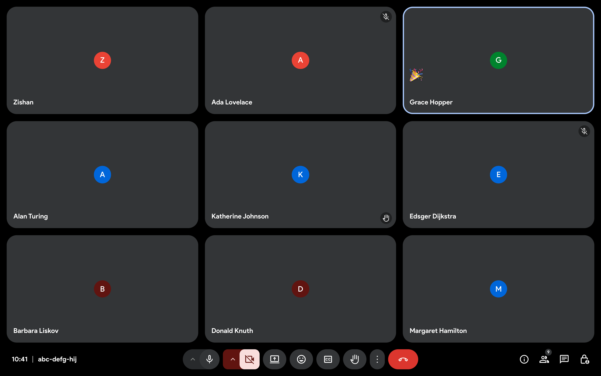
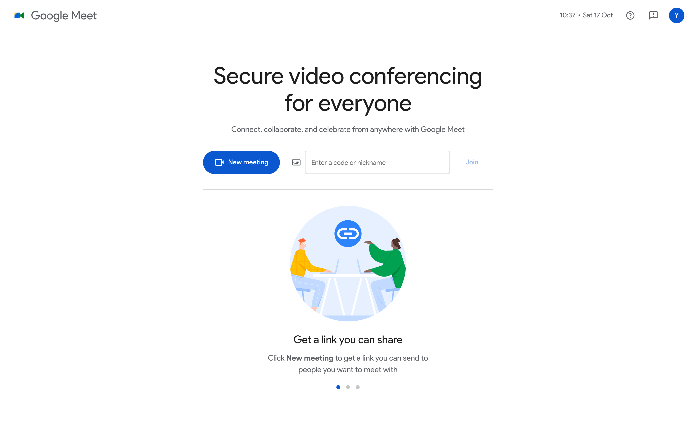
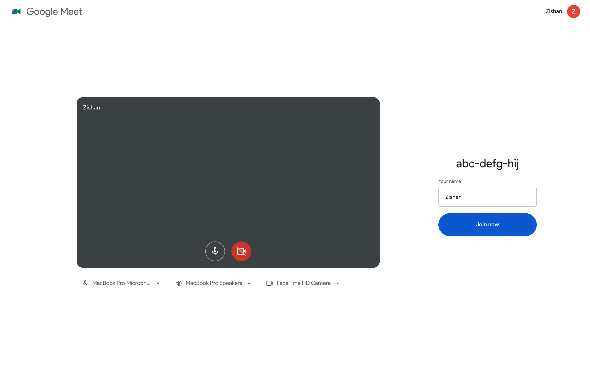
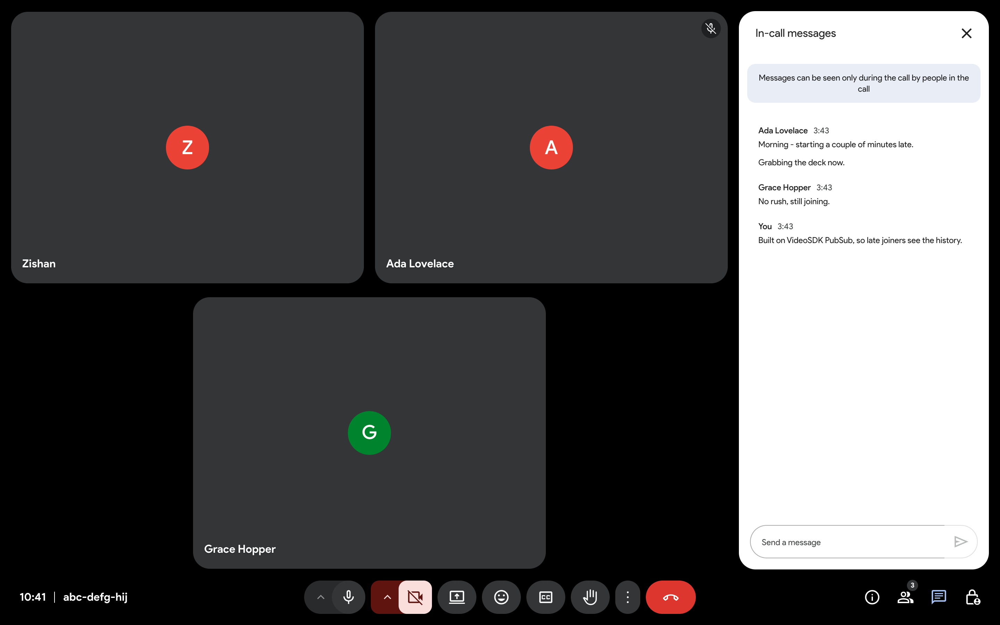
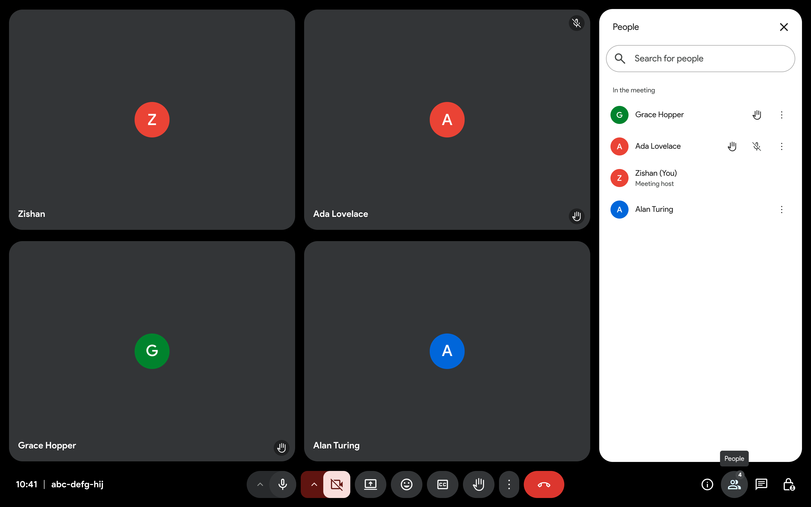
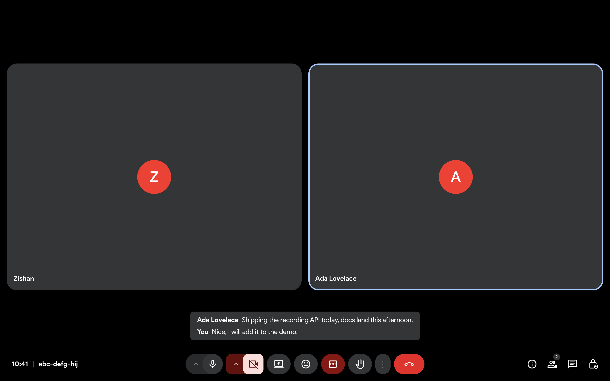
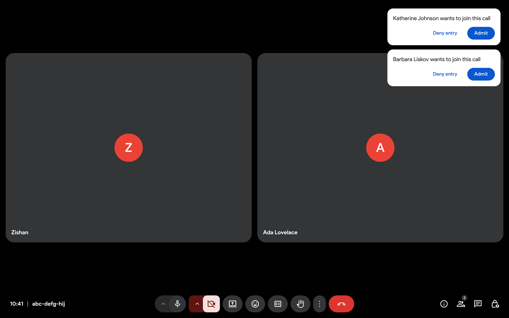
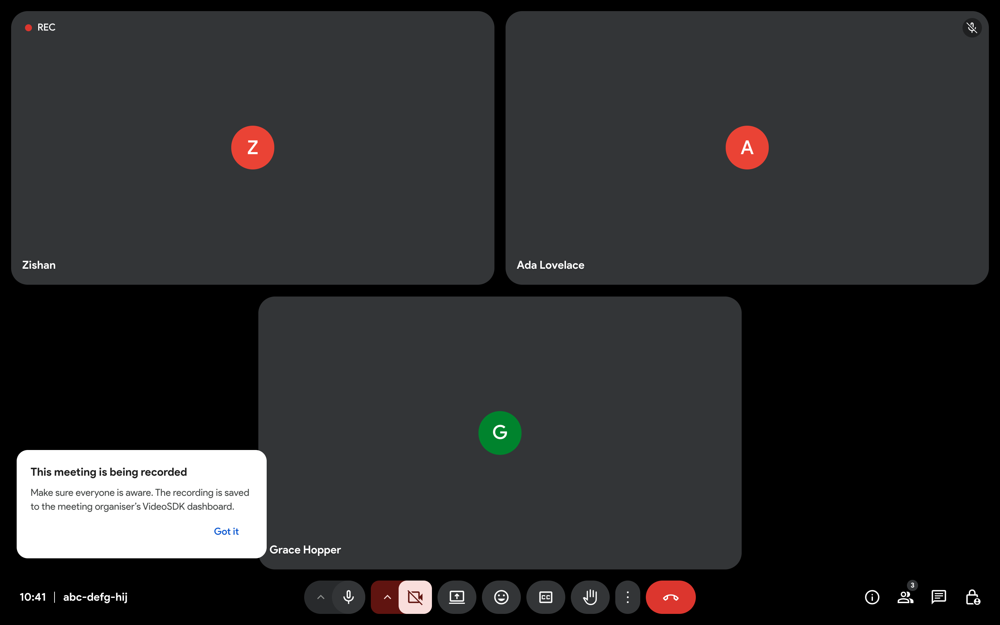
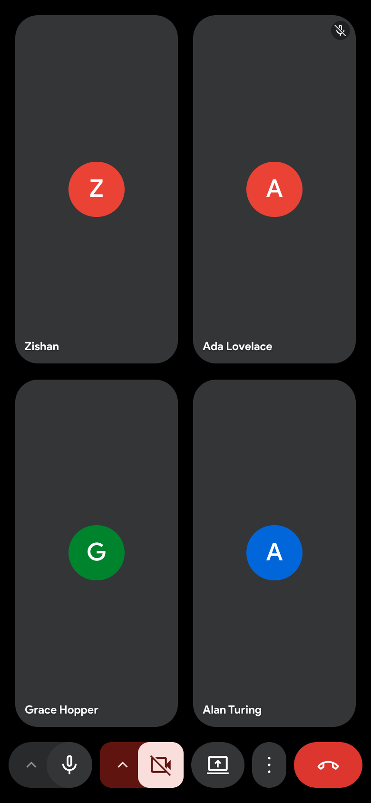

# Google Meet Clone - Open-Source Google Meet Web Client

A free, open-source **Google Meet clone** built with React, TypeScript, and [VideoSDK](https://videosdk.live).
It recreates the Google Meet web experience - real-time HD video and audio, screen share, chat, reactions, raise hand, live captions, cloud recording, and host-authoritative security controls - with a pixel-accurate UI matched to Figma references.

<div align="center">
  
[](https://youtu.be/HpAa3eld-bc)

[](https://react.dev)
[](https://www.typescriptlang.org)
[](https://docs.videosdk.live/react/guide/video-and-audio-calling-api-sdk/quick-start)
[](https://github.com/videosdk-community/google-meet-clone/stargazers)
[](LICENSE)

<div style="display:flex; margin: auto; justify-content: center; gap: 20px;">
<a href="https://google-meet-clone-by-videosdk.vercel.app/" target="_blank"></a>
<a href="https://docs.videosdk.live/react/guide/video-and-audio-calling-api-sdk/quick-start" target="_blank"></a>
<a href="https://youtu.be/HpAa3eld-bc" target="_blank"></a>
<a href="https://discord.gg/f2WsNDN9S5" target="_blank"></a>
</div>

<br />

[](https://vercel.com/new/clone?repository-url=https%3A%2F%2Fgithub.com%2Fvideosdk-community%2Fgoogle-meet-clone&env=VIDEOSDK_API_KEY,VIDEOSDK_SECRET&envDescription=Get%20a%20free%20API%20key%20and%20secret%20from%20the%20VideoSDK%20dashboard.&envLink=https%3A%2F%2Fdub.sh%2FX5Fn46e%3Futm_source%3Dgoogle_meet_clone_deploy_btn%26utm_medium%3Dgithub%26utm_campaign%3Dgoogle_meet_clone)

</div>

<br />
<br />

If you are looking for an **open source Google Meet** alternative to learn from, self-host, or use as a starting point for your own video conferencing app, this repo is a complete, working reference implementation.
Try it in the browser at the [live demo](https://google-meet-clone-by-videosdk.vercel.app/), or run it locally in under a minute.

## Screenshots

Every screenshot below is the app running on `localhost`.

| Landing page | Green room |
|---|---|
|  |  |
| **In-call chat** | **People panel with raised hands** |
|  |  |
| **Live captions** | **Waiting room** |
|  |  |
| **Cloud recording** | **Mobile web** |
|  |  |

## Why this project

Most "build a Meet clone" tutorials stop at two people on a call.
This one goes all the way to the parts that are actually hard: host-authoritative security with **server-minted role tokens** (not just disabled buttons), a real waiting room, late-joiner state sync over PubSub, cloud recording, and a green room whose live camera track is handed straight into the call so it never flickers.

- **Real WebRTC video conferencing** over VideoSDK's SFU, not a toy peer-to-peer example.
- **Production-minded architecture** - typed, linted, and covered by federated end-to-end tests, with the SDK hidden behind a single hook seam.
- **Pixel-accurate Meet UI** built from a Figma file, using the real Material Symbols icons and self-hosted Product Sans.

## Features

### Video and audio

- Real-time HD video and audio over the VideoSDK SFU
- Grid / gallery view with automatic, container-driven tile sizing
- Active-speaker (Spotlight) view with the rest of the room alongside
- Screen sharing
- Cloud recording with a live "Recording" indicator and a start/stop notice
- Per-tile network-quality indicator
- Mic / camera toggle with `Ctrl`+`D` / `Ctrl`+`E` hotkeys (Meet's real bindings)
- Device selection (mic, speaker, camera), applied live
- Pre-join green room with a mirrored camera preview and full error handling

### Collaboration and engagement

- Chat with persisted history, so late joiners see what they missed
- Floating emoji reactions (👍 🎉 ❤️ 😂 😮 😢 🙏 👏)
- Raise / lower hand, synced to everyone including late joiners
- Live captions - realtime transcription as a speaker-labeled overlay; each viewer toggles their own, and the first to enable it starts transcription for the room
- People panel with per-participant controls
- Pagination controls when the room outgrows one page of tiles

### Host and security controls (host-authoritative)

- Waiting room (lobby) - guests knock, the host admits or denies
- Mute a participant at the media server
- Ask a participant to unmute or turn their camera back on (asked, never forced - there is deliberately no force-unmute)
- Remove a participant
- Host vs guest is decided by a **server-signed grant**, not by the client

### Pre-meeting and landing

- Landing page with a feature carousel
- New meeting - creates a real VideoSDK room and makes you its host
- Join by meeting code / deep link
- Host role survives reload, with no database

## Tech stack

- **React 19** + **TypeScript 6**
- **Vite 8** build tooling
- **CSS Modules** with design tokens generated from Figma (no hand-written theme)
- **react-router-dom 7** for routing
- **@videosdk.live/react-sdk 0.13** for real-time media
- **Vercel serverless functions** (`api/`) for token and room minting
- **Vitest** for unit tests, **Playwright** for end-to-end tests
- **npm** package manager

## Quick start

```bash
npm install
cp .env.example .env
# paste your VideoSDK API key + secret into .env, then:
npm run dev          # http://localhost:5173
```

Get a free API key and secret from the [VideoSDK dashboard](https://dub.sh/X5Fn46e?utm_source=google_meet_clone&utm_medium=github&utm_campaign=google_meet_clone).
`npm run dev` serves the app **and** the `api/` endpoints, so New meeting and Join work against real VideoSDK rooms with no extra step.

Want to work on the UI with no credentials and no network? Append `?fake=ok` to any meeting URL:

```bash
open http://localhost:5173/abc-defg-hij?fake=ok
```

`localhost` is a secure context, so the camera works over plain HTTP; that switch is compiled out of production builds.
Add `&fake_call=` to stage a whole room: `nine`, `chat-history`, `hands-up`, `lobby-host`, `captions`, `recording`, or `presenting`.
The screenshots above were taken this way.

### Tokens are minted on the server, from your key + secret

VideoSDK tokens carry capabilities, so the **secret must never reach the browser**.
This app keeps it server-side and mints tokens per request:

- `api/rooms.ts` creates a room and returns a **host grant** signed with the secret.
- `api/token.ts` mints the meeting token. If the client presents a valid grant for that room it mints a **host** token (`allow_join` + `allow_mod`); otherwise it mints a **guest** token (`ask_join`, which lands the guest in the waiting room).

A client cannot ask to be host - it can only present a grant the server signed.
The host grant is the entire "creator is host" mechanism, and it works **without a database**: the client holds the grant in `localStorage` and re-presents it after a reload.

**Never prefix these with `VITE_`** - that would inline the secret into the bundle. `VIDEOSDK_API_KEY` and `VIDEOSDK_SECRET` are read only by `api/*.ts`. Never commit `.env`.

### Deploying

[](https://vercel.com/new/clone?repository-url=https%3A%2F%2Fgithub.com%2Fvideosdk-community%2Fgoogle-meet-clone&env=VIDEOSDK_API_KEY,VIDEOSDK_SECRET&envDescription=Get%20a%20free%20API%20key%20and%20secret%20from%20the%20VideoSDK%20dashboard.&envLink=https%3A%2F%2Fdub.sh%2FX5Fn46e%3Futm_source%3Dgoogle_meet_clone_deploy_btn%26utm_medium%3Dgithub%26utm_campaign%3Dgoogle_meet_clone)

Deploy to any host that runs the `api/` functions (Vercel is the zero-config path). Set two environment variables:

```
VIDEOSDK_API_KEY=your_key
VIDEOSDK_SECRET=your_secret
```

Then build (`npm run build`) and deploy. Tokens are minted by the functions at request time - there is nothing to paste and nothing baked into the client.

Because this is a single-page app with a real path route (`/:meetingId`), the host must rewrite unknown paths to `/index.html` so pasted meeting deep-links load instead of 404ing. On Vercel this is handled for you; on other static hosts add the equivalent SPA fallback.

## How it works

### The meeting

`/:meetingId` is **one route** that covers both the green room and the call.
`src/routes/Call/Room.tsx` shows the pre-join green room, then joins in place - the URL never changes, exactly as real Meet behaves.
`src/routes/Precall/` is the green room (camera preview, device pick, and every media-error state), and `src/routes/Call/` is the call itself: the stage, tiles, control bar, panels, host controls, recording, and the lobby.

### The SDK seam

VideoSDK's React SDK is hook-based (`MeetingProvider`, `useMeeting`, `useParticipant`, `usePubSub`), which resists wrapping in a plain object.
So the seam is at **our own hook layer**: components only ever call our hooks (`useParticipants`, `useLocalMedia`, `useDevices`, `useChat`, `useHostControls`, `useRecording`, `useLobby`, ...), and those delegate to either the real `VideoSdkCallClient` or a `FakeCallClient`.
**Components never import VideoSDK, and ESLint enforces it.** An SDK upgrade should touch `src/meeting/` and nothing else.

### Real-time media

VideoSDK provides an SFU (selective forwarding unit), so media does not go peer-to-peer.
The client authenticates with the server-minted token described above and joins the room; the green room's live camera and microphone tracks are passed straight into the call so nothing flickers off and on at join.

### Syncing state with PubSub

VideoSDK is stateless about chat, reactions, and raised hands, so those are coordinated app-side over PubSub topics.
Anything a late joiner must learn is published so it can be replayed from history, not only from live callbacks, so a client that subscribes a beat late still catches up.

| Topic | Persisted | Payload |
|---|---|---|
| `CHAT` | yes | chat messages (history for late joiners) |
| `HAND_RAISE` | yes | raise / lower, per participant |
| `REACTIONS` | no | floating emoji |

### Host-authoritative security

Security is enforced for real, not just by hiding buttons.
Host-ness is a **server-minted role token**, so a guest's client simply does not hold the capabilities to moderate.
On top of that, the host issues SDK commands the media server enforces:

- **Waiting room** - guests join with an `ask_join` token and are held in the lobby until the host admits or denies them.
- **Mute / disable camera** - enforced at the media server, not by asking the guest nicely.
- **Request mic / camera** - the host *asks*; the target may refuse. There is deliberately no force-unmute.
- **Remove** - ejects a participant from the room.

Because the host role is a signed token rather than an app-local flag, this avoids the client-trust ceiling that "disable the button" clones live with.

### Routes

- `/` - Landing page (new meeting, join by code).
- `/:meetingId` - green room, then the meeting.

## Project structure

```
src/
  design/
    tokens.css              # generated from Figma - never hand-edit
    primitives/             # Button, IconButton, Menu, Avatar, Tooltip, Icon...
  meeting/                  # the SDK seam
    CallClient.ts           # the interface every feature talks to
    VideoSdkCallClient.ts   # real implementation
    FakeCallClient.ts       # deterministic fake for tests + ?fake
    pubsubTopics.ts         # CHAT / HAND_RAISE / REACTIONS
    hooks/                  # useParticipants, useLocalMedia, useChat, useHostControls...
  routes/
    Landing/                # landing page + carousel
    Precall/                # green room and media-error states
    Call/                   # stage, tiles, control bar, panels, lobby, recording
  lib/
    session.ts              # display name + host grants, localStorage
api/
  token.ts                  # mints a host or guest meeting token from the grant
  rooms.ts                  # creates a room, returns { roomId, hostGrant }
  _lib/                     # token signing (underscore = not a route)
scripts/
  figma-pull.ts             # extract tokens + PNG renders from Figma
  tokens-build.ts           # tokens.css + tokens.d.ts (committed)
  icons-build.ts            # Material Symbols subset
  fonts-build.ts            # Product Sans woff2
  figma-diff.ts             # rendered screenshot vs Figma PNG
```

Design references and the token pipeline are documented in `docs/FIGMA.md`; locked decisions live in `docs/DECISIONS.md` and the VideoSDK API notes in `docs/VIDEOSDK.md`.

## Scripts

```bash
npm run dev           # start the app + api on http://localhost:5173
npm run build         # tsc -b, then vite build
npm run typecheck     # tsc -b
npm run lint          # eslint
npm test              # Vitest unit tests (no network)
npm run test:e2e      # Playwright against the fake client (fast, deterministic)
npm run test:e2e:live # small real-SDK suite (burns VideoSDK minutes - keep it small)
npm run figma:diff    # pixel deviation of a rendered screen vs its Figma frame
```

## Testing

- **Unit** (`npm test`) - Vitest over the hooks, the fake client, the token/room helpers, and pure logic. No network.
- **End-to-end** (`npm run test:e2e`) - Playwright drives the real UI against the `FakeCallClient`, so join, chat, reactions, hands, host controls, and the lobby are exercised with no camera and no VideoSDK minutes. Chromium runs with fake-media flags (`--use-fake-device-for-media-stream`, `--use-fake-ui-for-media-stream`) so contexts can join without real webcams.
- **Live** (`npm run test:e2e:live`) - a small suite against real VideoSDK rooms. It genuinely meets at the SFU, which is how two-party behaviour is verified. Keep it small; it burns minutes.

Visual baselines in `tests/e2e/visual.spec.ts` were generated on macOS and are treated as the source of truth there; regenerate them on whatever machine your CI runs on (`npx playwright test visual.spec.ts --update-snapshots`) and review the screenshots before committing.

## Keyboard shortcuts

- `Ctrl`+`D` (or `Cmd`+`D` on macOS) - toggle mic.
- `Ctrl`+`E` (or `Cmd`+`E` on macOS) - toggle camera.

Both are Meet's real bindings, and both are ignored while you are typing in an input or chat.

## FAQ

**Is this a real, working Google Meet clone?**
Yes. It runs genuine multi-participant WebRTC meetings over VideoSDK, with screen share, cloud recording, and host controls enforced at the media server.

**Do I need a VideoSDK account?**
Yes. You need a free VideoSDK key and secret. Get them from the [VideoSDK dashboard](https://dub.sh/X5Fn46e?utm_source=google_meet_clone&utm_medium=github&utm_campaign=google_meet_clone) and put them in `.env` - the server mints the meeting tokens for you.

**Can I self-host it?**
Yes. Set `VIDEOSDK_API_KEY` + `VIDEOSDK_SECRET` as env vars, run `npm run build`, and deploy anywhere that runs the `api/` functions (Vercel is zero-config).

**Is it free and open source?**
Yes. The code is open source and free to use as a learning resource or a starting point for your own project.

**What can I build on top of it?**
Team video conferencing tools, webinar apps, virtual classrooms, telehealth, or any product that needs a polished meeting UI plus real media and host controls.

**How is it different from real Google Meet?**
It clones the web UI and meeting mechanics, but there is no backend for accounts or persistence beyond `localStorage` and the stateless token/room functions. Host role is carried by a server-signed grant rather than a user account.

## Contributing

Issues and pull requests are welcome.
Before opening a PR, please run `npm run typecheck`, `npm run lint`, and `npm test`, and keep changes aligned with the Figma references (see `docs/FIGMA.md`).

## License

Released under the [MIT License](LICENSE). Free to use, modify, and distribute.

## Learn More

- [VideoSDK Documentation](https://docs.videosdk.live)
- [VideoSDK React SDK Reference](https://docs.videosdk.live/react/guide/video-and-audio-calling-api-sdk/quick-start)
- [VideoSDK PubSub Guide](https://docs.videosdk.live/react/api/sdk-reference/use-pubsub)

Built with [VideoSDK](https://videosdk.live).
